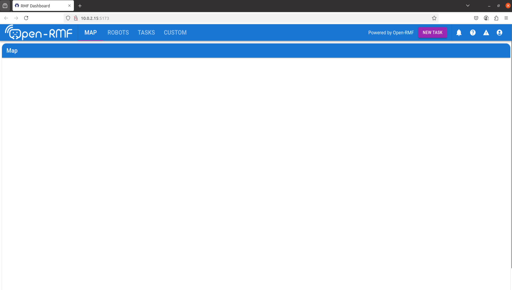

# RMF Web

Open-RMF Web is a collection of packages that provide **a web-based interface** for users to **visualize and control all aspects of Open-RMF deployments**.

## **Build** 🔨

**Download** the repository to your local workstation:

```bash
git clone git@bitbucket.org:cognicept/rmf_dashboard.git --branch devel/jazzy --depth 1 && cd rmf_dashboard
```

**Build** docker image using the command below:

```bash
docker build -t rmf_web_c_proxy:jazzy .
```
## **Setup**
### **Quick Setup** 🏎️
1. **Run** the following command:
```bash
bash scripts/easy_setup.bash <HOSTNAME>
```

To determine `HOSTNAME`, please run `ifconfig` bash command and determine which wifi interface's IP address you wish to use. Typically, `wlo1` interface is used.
```bash
#Eg.
bash scripts/easy_setup.bash $(ifdata -pa wlo1)
#Eg.
bash scripts/easy_setup.bash $(tailscale ip)
#Eg.
bash scripts/easy_setup.bash 10.10.1.112
#Eg. If you just want to run everything locally
bash scripts/easy_setup.bash 127.0.0.1
```

2. **Enter** `admin` when prompted with `Enter password for admin:`

3. Setup is now complete. 

> If no errors are encountered, **Skip** the **Manual Setup** below and **proceed** to **Run**. Otherwise, follow the steps in **Manual Setup**

### **Manual Setup** 🛞

1. **Create** a `ssl`, `keycloak_data` and `run_data` folder in project directory:
```bash
mkdir ssl && mkdir keycloak_data && mkdir run_data
```

2. **Put** your SSL cert and key files into the `ssl` folder. For testing, you can run the below commands to generate an SSL cert and key file
```bash
cd ssl
```
```bash
sudo apt update && sudo apt install -y libnss3-tools
```
```bash
wget https://github.com/FiloSottile/mkcert/releases/download/v1.4.4/mkcert-v1.4.4-linux-amd64
```
```bash
sudo chmod +x mkcert-v1.4.4-linux-amd64
```
```bash
sudo mv mkcert-v1.4.4-linux-amd64 /usr/local/bin/mkcert
```
```bash
mkcert -install
```
```bash
mkcert <HOSTNAME>
```

3. **Run** the following commands to give `keycloak_data` and `run_data` folders permissions:
```bash
sudo chmod 777 keycloak_data/ && sudo chmod 777 run_data/
``` 

These folders will be used to enable data persistence across docker boot-ups.

4. **Run** the following command to start a https keycloak server. **Replace** `<HOSTNAME>` with your hostname, `<SSL_CERT_FILENAME>` with your SSL certificate filename and `<SSL_KEY_FILENAME>` with your SSL key filename.
```bash
docker run -it --rm \
     --name keycloak-server \
     --network host \
     -e KEYCLOAK_ADMIN=admin \
     -e KEYCLOAK_ADMIN_PASSWORD=admin \
     -v ./keycloak_data:/opt/keycloak/data \
     -v ./ssl/<SSL_CERT_FILENAME>:/etc/x509/https/tls.crt \
     -v ./ssl/<SSL_KEY_FILENAME>:/etc/x509/https/tls.key \
     quay.io/keycloak/keycloak:25.0.2 start \
     --optimized \
     --proxy-headers=xforwarded \
     --hostname=<HOSTNAME> \
     --https-certificate-file=/etc/x509/https/tls.crt \
     --https-certificate-key-file=/etc/x509/https/tls.key
```
5. **Run** the following command to setup `rmf-web` realm and generate keycloak public key in project directory. **Replace** `<HOSTNAME> with your hostname.
```bash
bash keycloak-setup.bash -i <HOSTNAME> -u admin -o keycloak-example.pub
```

6. **Run** the following command to stop the keycloak server:
```bash
docker stop keycloak-server
```

7. **Fill up** the `.env` file with the correct values:
```bash
nano .env
```

8. **Replace** the `server_name` in `nginx.conf` with your `HOSTNAME`:
```bash
nano nginx.conf
```

## **Run** ⚙️

**Run** the following command to start the following 4 components:

- RMF Dashboard
- API server
- Keycloak Server
- Nginx

```bash
docker compose up
```

The dashboard will then accessible on `https://<HOSTNAME>` for devices on the same network.

## **Verify** ✅
You should see this page after logging in.
The username and password is <code>admin</code> and <code>admin</admin>


## **Running only RMF API server**

**Run** the following command to build the api server image:

```bash
docker build -f Dockerfile.api_server -t rmf_api_server:jazzy .
```

**Run** the following command to start the api server, keycloak server, and nginx:

```bash
docker compose -f docker-compose-no-frontend.yaml up
```

## **Maintainer(s)**
- Bey Hao Yun (Gary)
- Yan Renyu 
